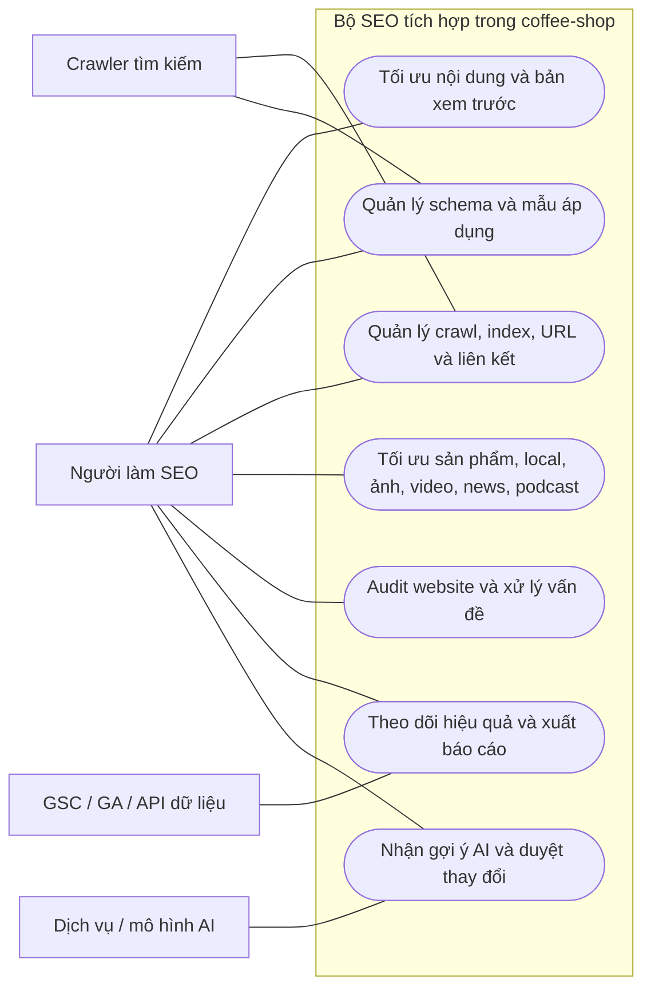

# Coffee-shop — use case SEO và đối chiếu Rank Math trả phí v0.1

> **DANH MỤC THAM CHIẾU — KHÔNG PHẢI BACKLOG ĐÃ DUYỆT.** Phạm vi hiện hành nằm tại [use case một người vận hành v0.2](cms-use-cases-solo.md). Bỏ các vai trò/phân quyền, báo cáo tổng hợp/gửi báo cáo, client management và đa thị trường; SEO-23…31 không còn mặc định là yêu cầu. Giữ công cụ tối ưu/chẩn đoán phù hợp trong editor và SEO kỹ thuật. Các nội dung chuyên biệt/AI bên dưới cần đối chiếu nhu cầu thực trước khi chọn; không yêu cầu dựng tất cả module chỉ để đạt danh sách tham chiếu.

Ngày đối chiếu: 01/11/2026. Đi cùng [bản đồ use case hệ thống](cms-use-cases.md).

**Mục tiêu:** tích hợp trực tiếp bộ công cụ SEO có độ phủ nghiệp vụ tương đương các khả năng Rank Math trả phí áp dụng cho coffee-shop. Không cần WordPress hoặc cài Rank Math. Chưa có chức năng trong bảng được triển khai/kiểm chứng bởi tài liệu này.

## 1. Định nghĩa “tương đương”

- Tương đương **hành vi và kết quả có thể kiểm chứng**, không phải giao diện giống hệt, số điểm trùng thuật toán riêng của Rank Math hoặc sử dụng trái phép dịch vụ của họ.
- Một nhóm tính năng không đồng nghĩa một checkbox đã hoàn tất: cần tách luồng, trường, quyền, dữ liệu, lỗi và nghiệm thu trước khi triển khai.
- Dùng cả SEO nền tảng và nâng cao làm chuẩn, không chỉ lấy phần được gắn nhãn PRO. Tính năng theo gói/quota có thể thay đổi; bảng này là snapshot tham chiếu, chưa phải kiểm toán đầy đủ từng dòng của nhà cung cấp.
- Chỉ một website coffee-shop: quản lý website khách hàng/agency, số license và hỗ trợ ưu tiên không phải use case sản phẩm. Local SEO nhiều địa điểm vẫn là nghiệp vụ khác, được giữ để đối chiếu.
- Rank Math AI có nhóm công cụ và giới hạn sử dụng riêng; phân tích riêng thay vì giả định mua SEO PRO là có AI không giới hạn. [Rank Math AI plans](https://rankmath.com/kb/content-ai-plans-and-features/)

Ký hiệu: **N** = tự xây xử lý nội bộ; **E** = cần nguồn dữ liệu/dịch vụ bên ngoài; **Q** = phụ thuộc mức sử dụng/quota; **A** = chỉ áp dụng khi loại nội dung/nghiệp vụ tương ứng tồn tại. Mọi dòng đang ở trạng thái **cần đặc tả**, không phải “đã đạt”.

## 2. Bản đồ nghiệp vụ SEO

## 3. Nội dung, metadata và liên kết

Đối chiếu [Titles & Meta](https://rankmath.com/kb/titles-and-meta/), [General Tab](https://rankmath.com/kb/general-tab/) và [bảng tính năng](https://rankmath.com/free-vs-pro/). Cột nghiệm thu là tiêu chí đề xuất cho coffee-shop, chưa phải cam kết thuật toán của sản phẩm gốc.

| Mã | Mục tiêu của người làm SEO | Kết quả/kiểm chứng cần đặc tả | Loại |
|---|---|---|---|
| SEO-01 | Đặt title/description theo trang và mẫu biến dùng chung | Override được ưu tiên đúng; không còn biến chưa thay trong HTML công khai | N |
| SEO-02 | Quản lý Open Graph, social cards, ảnh mặc định/riêng và watermark | Kiểm tra tag/ảnh đầu ra, fallback và phiên bản ảnh đúng khi đổi nội dung | N/Q |
| SEO-03 | Điều khiển robots meta, robots.txt và chỉ dẫn preview/snippet | Có kiểm tra xung đột; phân biệt chặn crawl, noindex và quyền truy cập | N |
| SEO-04 | Quản lý canonical, breadcrumb, danh mục chính và cấu trúc URL | Cùng nguồn dữ liệu giữa HTML và schema; không tạo canonical nhầm domain | N |
| SEO-05 | Xem trước kết quả tìm kiếm/social khi biên tập | Xem mô phỏng nội dung và cảnh báo độ dài; không cam kết search engine giữ nguyên snippet | N |
| SEO-06 | Phân tích nội dung theo nhiều từ khóa, pillar content và trường tùy chỉnh | Báo từng quy tắc: title, heading, URL, mô tả, nội dung, ảnh, link; giải thích điểm và cách sửa | N |
| SEO-07 | Gợi ý liên kết nội bộ, quản lý liên kết ngoài và luật keyword → URL | Duyệt/xem trước; tránh link tự trỏ, chèn lặp và chèn vào phần không được phép | N/Q |

Không biến “điểm SEO nội bộ” thành bằng chứng thứ hạng. Bộ quy tắc tiếng Việt cần bộ ví dụ kiểm chứng riêng; không tự nhận ngang chất lượng gợi ý ngữ nghĩa của AI.

## 4. Structured data và các loại nội dung chuyên biệt

Schema nâng cao có xây dựng tùy chỉnh, template và điều kiện áp dụng; xem [Custom Schema Generator](https://rankmath.com/kb/schema-generator/). Các loại còn lại đối chiếu tài liệu tương ứng tại từng dòng.

| Mã | Mục tiêu của người làm SEO | Kết quả/kiểm chứng cần đặc tả | Loại |
|---|---|---|---|
| SEO-08 | Chọn preset schema phù hợp và gắn nhiều thực thể trên một trang | Article, Product, Organization, LocalBusiness, FAQ/HowTo và các loại khác chỉ dùng khi nội dung tương ứng có thật; không trùng thực thể | N/A |
| SEO-09 | Tạo/sửa/nhập custom JSON-LD hoặc schema từ nguồn được phép | Có editor cấu trúc lồng, mảng, quan hệ và kiểm tra JSON; import URL không trở thành công cụ đọc mạng nội bộ | N/E |
| SEO-10 | Lưu schema template, ánh xạ trường, đặt điều kiện và kiểm tra đầu ra | Preview JSON-LD cuối, thứ tự rule xác định, phát hiện thiếu trường/xung đột; mở công cụ kiểm tra ngoài khi cần | N/E |
| SEO-11 | Bổ sung/quản lý alt, title, caption và luật thay thế ảnh | Ưu tiên giá trị đã biên tập; ảnh trang trí không bị nhồi alt; preview luật thay/casing/avatar. [Image SEO](https://rankmath.com/kb/image-seo/) | N |
| SEO-12 | Khai báo doanh nghiệp và một/nhiều địa điểm | Hồ sơ, giờ, địa chỉ, tọa độ, trang địa điểm, block thông tin và dữ liệu location/KML nhất quán. [Local SEO](https://rankmath.com/kb/local-seo/), [Sitemaps](https://rankmath.com/kb/configure-sitemaps/) | N/A |
| SEO-13 | Quản lý video SEO, phát hiện video và bổ sung dữ liệu | Video schema/sitemap đúng video thực; metadata lấy ngoài có cache và báo thiếu. [Video Sitemap](https://rankmath.com/kb/video-sitemap/) | N/E/A |
| SEO-14 | Công bố nội dung tin tức qua news sitemap | Có thông tin xuất bản và chỉ chọn nội dung đủ điều kiện theo quy tắc cần chốt. [News Sitemap](https://rankmath.com/kb/news-sitemap/) | N/A |
| SEO-15 | Xuất bản series/tập podcast cùng feed và structured data | Audio, tập, series và thông tin tác giả đúng; không sinh feed giả khi chưa có podcast. [Podcast SEO](https://rankmath.com/blog/optimize-podcast-for-seo/) | N/Q/A |

Preset nâng cao cần bảng riêng để tránh mất khả năng: Book, Course, Event, JobPosting, Music, Person, Recipe, Restaurant, Review, Service, SoftwareApplication, Video, Dataset, FactCheck/ClaimReview, Carousel, Speakable, Mentions/About và các kiểu Schema.org tùy chỉnh. Không tự tạo nội dung giả để bật preset. Preset và custom schema phục vụ hai công việc khác nhau, không coi một ô nhập JSON là đã thay thế toàn bộ trải nghiệm tạo schema. [Danh mục tham chiếu](https://rankmath.com/free-vs-pro/)

## 5. SEO kỹ thuật và công cụ quản lý

| Mã | Mục tiêu của người làm SEO | Kết quả/kiểm chứng cần đặc tả | Loại |
|---|---|---|---|
| SEO-16 | Quản lý redirect, lịch hiệu lực, regex, nhóm và đổi slug | Preview nguồn/đích, query policy, vòng lặp, chain, thứ tự rule; hỗ trợ 301/302/307 và xử lý 410/451 phù hợp. [Redirections](https://rankmath.com/kb/setting-up-redirections/) | N/Q |
| SEO-17 | Điều tra 404 theo URL, thời gian, referrer, user agent và xuất log | Gom số lần, lọc/xóa/xuất; không giữ vô hạn log bot. [404 Monitor](https://rankmath.com/kb/monitor-404-errors/) | N/Q |
| SEO-18 | Xem báo cáo link, tìm trang mồ côi/link gãy và sửa hàng loạt | Phân biệt 404 thật với timeout/chặn bot; preview thay link và hoàn tác. [AI Link Genius](https://rankmath.com/ai-link-genius/) | N/E/Q |
| SEO-19 | Quản lý sitemap XML/index/ảnh/HTML, submit và thông báo cập nhật | Chọn loại nội dung, loại trừ draft/noindex/redirect, chia sitemap; IndexNow hoặc API khác có kiểm tra điều kiện. [Sitemaps](https://rankmath.com/kb/configure-sitemaps/) | N/E/Q |
| SEO-20 | Sửa nhanh/lọc hàng loạt và nhập/xuất metadata, từ khóa, redirects, cấu hình | Dry-run, mapping, phát hiện lỗi, quyền và kết quả từng dòng. [Bulk Editing](https://rankmath.com/kb/bulk-editing-in-rank-math/), [Import/Export](https://rankmath.com/kb/import-export-settings/) | N/Q |
| SEO-21 | Audit sitewide và phân công/sửa vấn đề | Danh sách có bằng chứng, mức độ, URL liên quan, thời điểm kiểm tra và lần kiểm tra lại. [SEO Analysis](https://rankmath.com/kb/seo-analysis/) | N/E/Q |
| SEO-22 | Theo dõi tốc độ theo URL qua các lần đo | Ghi công cụ/thời gian/môi trường; phân biệt đo lab với dữ liệu người dùng thực; không bịa field data. [Bảng tính năng](https://rankmath.com/free-vs-pro/) | E/Q |

Google Indexing API chỉ áp dụng các loại nội dung được tài liệu cho phép, hiện là JobPosting hoặc BroadcastEvent trong VideoObject; không đặc tả nút “instant index mọi sản phẩm”. [Google Indexing API](https://developers.google.com/search/apis/indexing-api/v3/using-api)

## 6. Dữ liệu hiệu quả, từ khóa và báo cáo

Chuẩn đối chiếu chính: [Rank Math Analytics](https://rankmath.com/kb/analytics/), [SEO email reporting](https://rankmath.com/kb/seo-email-reporting/) và các tích hợp trong [bảng tính năng](https://rankmath.com/free-vs-pro/). Thiết kế dưới cần tách rõ dữ liệu do CMS tự tính và dữ liệu từ bên ngoài.

| Mã | Mục tiêu của người làm SEO | Kết quả/kiểm chứng cần đặc tả | Loại |
|---|---|---|---|
| SEO-23 | Kết nối GSC/GA, chọn property, đồng bộ dữ liệu và kiểm tra index | OAuth đúng scope, ngắt kết nối/thu hồi, lịch sync, URL Inspection theo quota và trạng thái dữ liệu | E/Q |
| SEO-24 | Xem clicks/impressions/CTR/average position theo trang/query/quốc gia/thiết bị | Cùng dimension và bộ lọc với nguồn; ghi độ trễ/độ phủ; drill down một trang | E/Q |
| SEO-25 | Chọn từ khóa theo dõi và xem lịch sử vị trí | Ghi rõ nguồn GSC hay SERP độc lập; từ khóa chưa có dữ liệu không thành “hạng 0” | E/Q |
| SEO-26 | Tìm bài/từ khóa tăng giảm, so kỳ và đọc hiệu quả từng nội dung | Đặt được kỳ, ngưỡng, đơn vị; không so hai tập dữ liệu khác bộ lọc mà giấu khác biệt | N/E/Q |
| SEO-27 | Nhận biết traffic đến từ AI search | Phân loại nguồn/referrer theo quy tắc công khai, ghi giới hạn nhận diện | N/E/Q |
| SEO-28 | Xem dữ liệu doanh thu AdSense nếu coffee-shop sử dụng | Có tài khoản/quyền và dữ liệu thật; không liên quan nếu shop không chạy quảng cáo | E/A |
| SEO-29 | Nghiên cứu xu hướng/gợi ý từ khóa với nguồn xác định | Nêu rõ nguồn, thời điểm, quốc gia; không tự gọi bộ từ khóa tự sinh là search volume thật | E/Q |
| SEO-30 | Nhận/xuất báo cáo định kỳ | Có chỉ số, kỳ, người nhận, trạng thái gửi và retry; không cần email thì tải báo cáo trong admin | N/E/Q |
| SEO-31 | Tùy chỉnh báo cáo theo nhận diện coffee-shop và lịch lưu dữ liệu | Template/header/footer riêng; không triển khai dashboard agency hoặc quản lý website khách hàng | N/Q |

GSC không bảo đảm trả mọi dòng dữ liệu mà có giới hạn nội bộ và ưu tiên các dòng hàng đầu. Vì vậy báo cáo phải thể hiện giới hạn; dữ liệu GSC không được quảng cáo thành hệ theo dõi SERP độc lập cho mọi truy vấn. [Search Analytics API](https://developers.google.com/webmaster-tools/v1/searchanalytics/query)

## 7. SEO thương mại và trải nghiệm biên tập

| Mã | Mục tiêu của người làm SEO | Kết quả/kiểm chứng cần đặc tả | Loại |
|---|---|---|---|
| SEO-32 | Tối ưu trang sản phẩm/biến thể | Product/Offer, giá, tiền tệ, tồn, brand, SKU, GTIN/MPN, gallery/social/sitemap và phân tích nội dung sản phẩm; đồng bộ đúng dữ liệu bán hàng. [WooCommerce SEO comparison](https://rankmath.com/kb/woocommerce-seo-feature-comparison/) | N |
| SEO-33 | Kiểm soát archive, phân trang, lọc tìm kiếm, media và nội dung bảo vệ | Quy tắc canonical/noindex theo loại URL; trang private phải thực sự chặn truy cập, không chỉ gắn noindex. [Titles & Meta](https://rankmath.com/kb/titles-and-meta/) | N |
| SEO-34 | Thiết lập SEO ban đầu, phân quyền và chuyển cấu hình | Có wizard/checklist tương ứng, quyền xem/sửa/xuất bản, backup/restore cấu hình. [Role Manager](https://rankmath.com/kb/role-manager/), [Import/Export](https://rankmath.com/kb/import-export-settings/) | N |
| SEO-35 | Tối ưu sản phẩm số tương đương mục tiêu của EDD SEO | Áp quy tắc sản phẩm số nếu shop bán; không cần dựng hoặc phụ thuộc plugin EDD. [Bảng tính năng](https://rankmath.com/free-vs-pro/) | N/A |
| SEO-36 | Tối ưu ngay trong editor/block/custom field của CMS tự xây | SEO đọc đủ nội dung thực; FAQ/HowTo/breadcrumb và metadata có một nguồn đúng, không phụ thuộc Elementor/Divi/bbPress. [Advanced Mode](https://rankmath.com/kb/advanced-mode/) | N/A |

Không port `.htaccess` sang Cloudflare; yêu cầu tương đương là quy tắc redirect thực thi đúng trong môi trường đích. Không xây adapter Elementor/Divi/bbPress khi hệ thống không dùng chúng; các mục tiêu breadcrumb, FAQ/Q&A, phân tích block và schema tự động phải được ánh xạ vào editor coffee-shop, hoặc ghi không áp dụng nếu không có loại nội dung đó.

## 8. AI và trợ lý tự động — ghi riêng, không mặc định có ngân sách

Rank Math hiện mô tả Content AI, AI Link Genius và AI Visibility thành nhóm Rank Math AI. Các use case dưới giữ mục tiêu nghiệp vụ để đánh giá $0, không hứa truy cập dịch vụ Rank Math miễn phí. [Rank Math AI plans](https://rankmath.com/kb/content-ai-plans-and-features/)

| Mã | Mục tiêu | Kết quả/kiểm chứng cần đặc tả | Chi phí/giới hạn cần giải quyết |
|---|---|---|---|
| AI-01 | Nghiên cứu, lập dàn ý, viết/viết lại/dịch/tối ưu, sinh metadata và alt | Chọn đầu vào/ngôn ngữ/tone; xem diff, duyệt trước khi thay, lưu nguồn và cảnh báo dữ kiện chưa xác minh | Chưa chọn mô hình; free quota/local đều cần kiểm chứng tài nguyên và điều kiện sử dụng |
| AI-02 | Gợi ý liên kết theo ngữ nghĩa và tự động hóa liên kết | Chỉ rõ đoạn/vị trí/đích/lý do, duyệt hàng loạt, rollback; không tự sửa phần chưa được phép | Luật từ khóa miễn phí không được tự coi là ngang chất lượng gợi ý ngữ nghĩa |
| AI-03 | Theo dõi thương hiệu trong câu trả lời AI và so đối thủ | Lưu prompt/nền tảng/thời gian/khu vực/câu trả lời/nguồn dẫn; phân biệt mentions, citations và sentiment | Cần nguồn dữ liệu và quyền truy cập; chưa có phương án $0 được kiểm chứng cho mọi nền tảng |
| AI-04 | Cho trợ lý gọi công cụ SEO có kiểm soát | Truy vấn metadata/schema/audit/cấu hình; thao tác sửa có scope, preview/diff, xác nhận phù hợp và audit log | API/MCP không tự đòi mô hình trả phí, nhưng công cụ không cung cấp miễn phí phần suy luận. [MCP Tools](https://rankmath.com/kb/mcp-tools/) |

## 9. Ma trận khả thi 0 USD sơ bộ

Đây là đánh giá phân tích, chưa phải kết quả benchmark hoặc chốt kiến trúc.

| Nhóm | Có thể tự xử lý ở đâu về mặt nghiệp vụ | Phần chưa được chứng minh |
|---|---|---|
| Metadata, JSON-LD, sitemap, robots, redirects, phân tích theo rule | Nội dung + cấu hình của chính coffee-shop | CPU, correctness, cache và quy mô trong quota |
| 404, link graph, orphan, audit | Log và dữ liệu nội bộ; fetch kiểm tra khi cần | Giới hạn log/crawl, lịch kiểm tra, website ngoài chặn truy cập |
| Analytics và theo dõi từ khóa dựa trên GSC | Dashboard của shop + API property được cấp quyền | Quota, độ trễ, thời gian lưu, từ khóa không có dữ liệu |
| SERP độc lập / xu hướng / dữ liệu cạnh tranh | Cần nguồn được phép sử dụng | Không mặc định có dữ liệu đầy đủ miễn phí hoặc scrape không giới hạn |
| Báo cáo email | Có thể tạo báo cáo trong admin không cần gửi email | Ngang chức năng gửi tự động cần nhà cung cấp/phương án gửi $0 được chứng minh |
| Content AI / liên kết ngữ nghĩa / AI visibility | Có thể thiết kế giao diện, quyền và luồng duyệt | Mô hình, tài nguyên, dữ liệu và chất lượng tương đương trong ngân sách 0 |

Tổng chi phí $0 là tiêu chí nghiệm thu độc lập với “chạy được trên Cloudflare”. Không một ô “tự viết được” nào bảo đảm miễn phí ở mọi lưu lượng. Điều kiện quota được ghi tại [bản đồ hệ thống](cms-use-cases.md#8-kiểm-chứng-yêu-cầu-cloudflare-miễn-phí).

## 10. Điều kiện để ký độ phủ SEO

- [ ] Lập snapshot đầy đủ tính năng tham chiếu, phân biệt free/PRO/Business/Agency/AI và điều kiện sử dụng thực tế.
- [ ] Mỗi tính năng tham chiếu ánh xạ đến ít nhất một use case; không áp dụng phải ghi lý do theo phạm vi một coffee-shop.
- [ ] Tách nhóm use case thành luồng cụ thể, trường, quyền, lỗi và ca nghiệm thu; bảo đảm cả thao tác lẻ và bulk.
- [ ] Chốt danh sách preset/schema thuộc phạm vi và cách nhập/ánh xạ dữ liệu; kiểm tra đầu ra trên bộ trang mẫu thật.
- [ ] Kiểm tra canonical/robots/sitemap/redirect/schema không xung đột và không rò draft/private.
- [ ] Kiểm tra dữ liệu GSC/GA với mẫu nguồn; thể hiện thiếu dữ liệu, độ trễ và thời gian lưu đúng.
- [ ] Chứng minh phần phụ thuộc bên ngoài đáp ứng 0 USD ở quy mô đã chọn, hoặc ghi rõ khoảng trống chưa đáp ứng.
- [ ] Không đánh dấu tương đương nếu thay tác vụ tự động bằng hướng dẫn làm tay mà chưa chấp nhận thay đổi yêu cầu.
- [ ] Không dùng điểm SEO, JSON-LD hợp lệ hoặc submit API làm cam kết tăng hạng/được index/được rich result.

**Hiện trạng:** đã có bản đồ và nguồn chính thức để rà soát; chưa tuyên bố đạt đầy đủ Rank Math trả phí, chưa chọn dịch vụ trả phí và chưa triển khai code.
