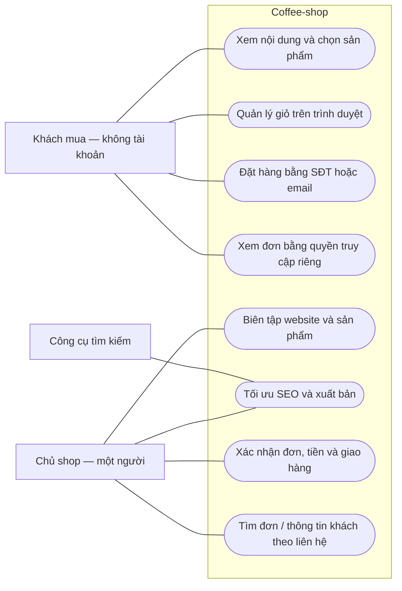

# Coffee-shop — use case cho một người vận hành, guest checkout

Phiên bản 0.2 · 01/11/2026 · Tài liệu làm việc hiện hành. Thay phạm vi của bản đồ v0.1; chưa triển khai code.

## 1. Phạm vi đã xác nhận

- Chỉ phục vụ coffee-shop; một người thực hiện toàn bộ việc quản trị nội dung, SEO, sản phẩm và xử lý đơn.
- Khách dùng giỏ hàng lưu tại trình duyệt; đặt hàng bằng thông tin liên hệ **SĐT hoặc email**, không đăng ký username/password.
- Ghi nhận hồ sơ khách từ thông tin đặt hàng để chủ shop xử lý và tìm đơn; không có trang quản lý tài khoản khách.
- Không xây marketing, B2B, đa thị trường, dashboard/báo cáo tổng hợp, quản lý nhân viên/phân quyền, màn hình khôi phục hoặc quản lý chi phí.
- Giữ nội dung website, bán hàng và công cụ SEO nâng cao phù hợp phạm vi. Không xây cơ chế plugin.
- Chi phí mục tiêu $0 ngoài domain; đây là giới hạn thiết kế, không phải yêu cầu xây một module quản lý chi phí.

Một người vận hành là một tác nhân admin. Không dựng tác giả, SEO, nhân viên kho thành các tài khoản/vai trò riêng. Admin vẫn cần được bảo vệ khỏi người ngoài; không cần hệ quản trị người dùng/RBAC để thực hiện việc này.

Các nền tảng WordPress/WooCommerce/Shopify/Rank Math là nguồn tham chiếu, không còn mặc định biến toàn bộ tính năng thành yêu cầu. Những loại nghiệp vụ chưa cần cho sản phẩm cà phê, như POS, subscriptions, hàng số, đa kho, không được tự thêm vì sản phẩm tham chiếu có chúng.

## 2. Phương pháp đề xuất và cơ sở tham chiếu

| Cách làm | Dùng vào việc gì | Áp dụng cho coffee-shop |
|---|---|---|
| User Story Mapping của Jeff Patton | Nhìn mục tiêu và công việc theo hành trình; thấy chỗ thiếu trước khi liệt kê màn hình | Một hàng hành trình khách mua, một hàng công việc chủ shop; chi tiết nằm dưới từng bước. [Tài liệu gốc](https://jpattonassociates.com/story-mapping-quick-ref/) |
| Use-Case 2.0 của Ivar Jacobson International | Mô tả mục tiêu, kịch bản và chia theo các lát có giá trị kiểm chứng | Mỗi use case có luồng thành công, nhánh lỗi và nghiệm thu; chưa cần sơ đồ UML phức tạp. [Hướng dẫn gốc](https://www.ivarjacobson.com/publications/articles/use-cases-ultimate-guide) |
| Ví dụ Given–When–Then | Chốt hành vi quan sát được từ bối cảnh, hành động và kết quả | Viết vài ví dụ nghiệm thu cho đặt hàng, thay giá, hết hàng và xuất bản. Không cần cài Cucumber chỉ để dùng cách viết. [Gherkin reference](https://cucumber.io/docs/gherkin/reference/) |
| WooCommerce core critical flows | Bộ luồng thương mại thực tế để rà độ phủ | Rà shop → product → cart → checkout → order; bỏ phần tài khoản và nghiệp vụ ngoài phạm vi. [Bộ luồng chính thức](https://developer.woocommerce.com/docs/contribution/testing/core-critical-flows/) |

Đây là lựa chọn phương pháp phù hợp dự án, không phải bảng xếp hạng mức sử dụng toàn ngành. Không có một bộ use case thương mại điện tử duy nhất mà mọi shop phải triển khai toàn bộ.

Giữ tinh thần waterfall ở mức **chốt mục tiêu → hành trình → use case/quy tắc → dữ liệu/giao diện → triển khai/nghiệm thu**. Chốt luồng và ví dụ giúp giảm thay đổi do hiểu sai; không cần viết đặc tả mọi tình huống của Shopify trước khi xác định nhu cầu coffee-shop.

## 3. Story map

| Hành trình | Bước 1 | Bước 2 | Bước 3 | Bước 4 | Bước 5 |
|---|---|---|---|---|---|
| Khách mua | Khám phá thương hiệu/sản phẩm | Chọn gói và số lượng | Kiểm tra giỏ local | Nhập thông tin, xác nhận đặt | Giữ thông tin đơn và theo dõi |
| Chủ shop | Chuẩn bị nội dung/sản phẩm | Kiểm tra SEO và xuất bản | Nhận, xác nhận đơn | Ghi nhận tiền và giao hàng | Xử lý hoàn tất/hủy/đổi trả |

Story map diễn tả hành trình tổng quát, không mô tả chính xác thứ tự mọi sự kiện hoặc transaction. Với tiền/tồn/trạng thái cần đặc tả riêng.

## 4. Sơ đồ tác nhân và use case tổng quan

Đây là use case trình bày bằng Mermaid flowchart: đường nối là tham gia, không phải luồng dữ liệu. Thanh toán/vận chuyển/email chỉ thêm thành tác nhân tích hợp khi thực sự chọn kết nối; làm thủ công không buộc phải có API.

## 5. Danh mục đề xuất để đặc tả

24 mục dưới là tập mục tiêu đề xuất theo phạm vi mới, không phải 24 chức năng đã nghiệm thu. Tách chi tiết theo hành vi cần thiết, không tách từng nút thành một use case.

| Mã | Tác nhân | Mục tiêu | Kết quả thành công |
|---|---|---|---|
| K-01 | Khách | Khám phá website | Đọc được thương hiệu, câu chuyện, liên hệ và thông tin mua |
| K-02 | Khách | Tìm sản phẩm | Duyệt danh mục; tìm/lọc ở mức danh mục thực tế cần |
| K-03 | Khách | Chọn sản phẩm/gói | Thấy đúng mô tả, khối lượng, giá và khả năng mua |
| K-04 | Khách | Thêm/sửa/xóa giỏ | Giỏ đúng sản phẩm, biến thể nếu có và số lượng |
| K-05 | Khách | Tiếp tục giỏ trên cùng trình duyệt | Đóng/mở trang vẫn có giỏ nếu bộ nhớ trình duyệt còn khả dụng |
| K-06 | Khách | Kiểm tra lại giỏ | Nhận thông tin mới về giá, sản phẩm ngừng bán hoặc thiếu hàng |
| K-07 | Khách | Đặt hàng không tài khoản | Nhập tên, ít nhất một liên hệ hợp lệ và thông tin nhận hàng phù hợp |
| K-08 | Khách | Chọn cách nhận/trả tiền | Hiểu phí, tổng tiền và hướng dẫn của phương thức đang hỗ trợ |
| K-09 | Khách | Nhận xác nhận đơn | Có mã đơn, snapshot số tiền và trạng thái thực tế |
| K-10 | Khách | Xem lại đúng đơn của mình | Dùng quyền truy cập riêng cho đơn; không cần đăng ký |
| K-11 | Khách | Liên hệ sửa/hủy/đổi trả | Gửi yêu cầu gắn đúng đơn; chủ shop xử lý theo trạng thái |
| C-01 | Chủ shop | Truy cập admin riêng | Chỉ chủ shop thực hiện được thao tác quản trị |
| C-02 | Chủ shop | Biên tập website | Sửa nội dung, menu, thông tin chung và trang đã xác định |
| C-03 | Chủ shop | Quản lý ảnh/video | Tải/chọn/thay media, mô tả và kiểm tra chỗ sử dụng |
| C-04 | Chủ shop | Quản lý danh mục/sản phẩm | Tạo/sửa/ẩn và sắp xếp sản phẩm/gói với dữ liệu hợp lệ |
| C-05 | Chủ shop | Quản lý giá và khả năng bán | Giá/tình trạng/giới hạn số lượng có một nguồn đúng |
| C-06 | Chủ shop | Tối ưu nội dung trước xuất bản | Chỉnh metadata, xem gợi ý SEO và bản xem trước ngay nơi biên tập |
| C-07 | Chủ shop | Quản lý SEO kỹ thuật/nâng cao | Schema, sitemap, robots, canonical, redirects và công cụ sửa vấn đề phù hợp |
| C-08 | Chủ shop | Xem trước và xuất bản | Nội dung mới xuất hiện nhất quán; draft chưa công khai |
| C-09 | Chủ shop | Tiếp nhận/xác nhận đơn | Biết đơn mới, kiểm tra thông tin và ghi nhận xác nhận/chưa xử lý |
| C-10 | Chủ shop | Tìm đơn/thông tin khách | Tìm theo mã đơn, SĐT hoặc email; không cần quản trị tài khoản khách |
| C-11 | Chủ shop | Cập nhật tiền và giao hàng | Tách được đã trả/chưa trả với đang xử lý/đã giao |
| C-12 | Chủ shop | Xử lý hủy/hoàn/đổi | Ghi lại đúng tác động đến đơn, tiền và khả năng bán |
| C-13 | Chủ shop | Tạo/sửa đơn hỗ trợ khách | Ghi đơn từ cuộc gọi/tin nhắn và thay đổi hợp lệ, không sửa mất lịch sử cũ |

Phương thức thanh toán, biểu phí giao hàng, cách theo dõi tồn và quy trình đổi trả chưa được người dùng chốt chi tiết. Đề xuất ban đầu để đạt $0 là chuyển khoản/COD và cập nhật thủ công; không tự coi kết nối cổng thanh toán/đơn vị vận chuyển là yêu cầu đã duyệt.

## 6. Giỏ local — quy tắc đề xuất

- `localStorage` giữ sản phẩm/biến thể và số lượng; có version và thời điểm cập nhật để xử lý dữ liệu cũ. Không tạo “tài khoản local”.
- Giỏ có thể còn qua các lần mở trình duyệt, nhưng phụ thuộc origin, chế độ riêng tư và thiết lập lưu trữ. Không đồng bộ qua máy khác. Cần xử lý lỗi đọc/ghi mà khách vẫn mua được. [MDN localStorage](https://developer.mozilla.org/en-US/docs/Web/API/Window/localStorage)
- Tên/ảnh/giá lưu để hiển thị nhanh chỉ là cache. Hệ thống lấy giá, khả năng bán, thuế/phí và tính tổng lại từ dữ liệu tin cậy trước khi tạo đơn.
- Không giữ tồn khi khách chỉ thêm giỏ. Chính sách giữ/trừ/nhả tồn bắt đầu lúc nào cần chốt theo cách xác nhận đơn.
- Giá đổi hoặc sản phẩm không còn bán phải hiển thị rõ để khách xác nhận; không âm thầm đặt với giá khác.
- Chỉ bỏ các item đã đặt khỏi giỏ sau khi hệ thống xác nhận tạo đơn thành công. Nếu có item được thêm trong lúc gửi đơn, không xóa nhầm item đó.
- Bấm lặp, retry hoặc mất mạng không được tạo đơn trùng. Thông tin đơn đã lưu trên hệ thống là nguồn thật, không phải dữ liệu trong trình duyệt.
- Không mặc định lưu địa chỉ/SĐT/email hoặc toàn bộ đơn vào localStorage. Nếu cần “nhớ thông tin”, đó là lựa chọn riêng của khách với cách xóa rõ ràng.

## 7. Hồ sơ khách từ SĐT/email — tách nhận diện và quyền truy cập

### Quy trình phù hợp yêu cầu

1. Khách nhập thông tin lúc đặt hàng; không có bước tạo tài khoản.
2. Đơn giữ snapshot tên, liên hệ và địa chỉ của lần đặt đó.
3. Hệ thống ghi nhận hồ sơ liên hệ nội bộ; chủ shop tra đơn theo SĐT/email. Có thể nhóm để hỗ trợ, nhưng thông tin chưa xác minh chỉ là dấu hiệu trùng liên hệ.
4. Khách nhận quyền xem **một đơn cụ thể** trên trang xác nhận, ví dụ một link tra cứu bí mật do hệ thống tạo và kiểm tra. Không cần SMS/email OTP cho bước đặt hàng.
5. Khách giữ link để xem lại/đổi máy; nếu mất link, liên hệ chủ shop xác minh và hỗ trợ. Không dựng cổng đăng nhập chỉ để giải quyết trường hợp này.

WooCommerce cho phép guest checkout mà đơn không gắn tài khoản WordPress. Shopify cho phép chọn SĐT hoặc email làm liên hệ checkout; khi truy cập tài khoản, Shopify dùng bước xác minh riêng. Đây là hai năng lực độc lập. [Woo guest checkout](https://woocommerce.com/document/configuring-woocommerce-settings/accounts-and-privacy/), [Shopify checkout contact](https://help.shopify.com/en/manual/checkout-settings/checkout-form-options), [Shopify passwordless accounts](https://help.shopify.com/en/manual/customers/customer-accounts)

### Quy tắc dữ liệu và truy cập

- Dùng ID nội bộ ổn định cho đơn/hồ sơ; SĐT/email là trường liên hệ có thể sửa, không phải khóa chính hoặc mật khẩu.
- Giữ cả liên hệ gốc và dạng chuẩn hóa để tìm kiếm. Chuẩn hóa SĐT có ngữ cảnh quốc gia; không áp quy tắc Gmail như bỏ dấu chấm/+tag cho mọi email.
- Không tự nhập hai hồ sơ thành một chỉ vì đơn mới chứa SĐT trùng hồ sơ A và email trùng hồ sơ B; không mở lịch sử đơn cũ cho người mới nhập liên hệ đó.
- Chỉ biết SĐT/email không được xem/sửa toàn bộ đơn của người mang liên hệ đó. API phải kiểm tra quyền trên từng đơn. Đây là áp dụng nguyên tắc kiểm soát truy cập theo đối tượng. [OWASP IDOR prevention](https://cheatsheetseries.owasp.org/cheatsheets/Insecure_Direct_Object_Reference_Prevention_Cheat_Sheet.html)
- Link tra cứu là quyền truy cập có phạm vi, không chỉ một mã đơn khó đoán. Đề xuất chỉ cho xem thông tin cần thiết; có thể hết hạn/thu hồi; không gắn vào analytics hoặc tài nguyên bên thứ ba. Ai giữ link có thể dùng quyền đó, nên không mặc định cho sửa liên hệ/hoàn tiền qua link.
- Dùng email khi khách muốn nhận email; cần SĐT người nhận nếu cách giao hàng đòi hỏi. Không ép cung cấp cả hai chỉ để tạo hồ sơ.
- Nếu sau này muốn khách xem mọi đơn trên máy mới bằng SĐT/email, cần use case xác minh quyền sở hữu liên hệ. Chưa đưa OTP/SMS hoặc đăng nhập passwordless vào phạm vi hiện tại.

Baymard quan sát việc yêu cầu tạo tài khoản trong checkout có thể làm gián đoạn mục tiêu hoàn tất mua. Với phạm vi hiện tại, không thêm lời mời tạo tài khoản. [Nghiên cứu guest checkout](https://baymard.com/research-articles/delayed-account-creation)

## 8. SEO sau khi thu gọn phạm vi

- Giữ nhóm công cụ phục vụ thao tác trực tiếp: title/description/social, từ khóa và phân tích nội dung, schema/preset/template, SEO sản phẩm/ảnh, canonical/robots/sitemap, redirect/404/link gãy và kiểm tra kỹ thuật.
- Một người dùng tất cả công cụ; không có vai trò SEO riêng, quy trình duyệt nhiều người hoặc quản lý quyền SEO.
- Bỏ dashboard/báo cáo tổng hợp, gửi báo cáo, client management, marketing và đa thị trường. Đề xuất loại khỏi phạm vi hiện hành cả báo cáo hiệu quả/từ khóa tổng hợp; giữ kết quả kiểm tra nội dung ngay tại editor. Đây là cách diễn giải hiện tại của yêu cầu “không cần báo cáo”, chưa phải yêu cầu bỏ mọi công cụ chẩn đoán SEO.
- News/video/podcast/local/custom schema chỉ áp dụng theo loại nội dung cần xuất bản; không tạo module nội dung giả để bật hết danh sách Rank Math.
- AI và dữ liệu ngoài không tự trở thành bắt buộc; mục tiêu $0 vẫn áp dụng. Danh mục đối chiếu SEO cũ chỉ còn là nguồn tham khảo, không phải backlog đã duyệt.

## 9. Đặc tả mẫu: K-07 đặt hàng không tài khoản

**Tác nhân:** khách. **Kích hoạt:** xác nhận đặt hàng. **Tiền điều kiện:** giỏ có item; shop có cách nhận và trả tiền đang hỗ trợ.

**Luồng chính:** nhập liên hệ/thông tin nhận → chọn nhận/trả tiền → hệ thống kiểm tra giỏ và tính lại tổng → khách xác nhận thông tin cuối → ghi một đơn duy nhất → trả mã đơn/quyền tra cứu/hướng dẫn → xóa đúng phần giỏ đã đặt.

**Nhánh lỗi:** giá đổi cần xác nhận lại; thiếu liên hệ/địa chỉ thì chỉ đúng lỗi; hết hàng không nhận sai số lượng; gửi lại cùng yêu cầu trả cùng kết quả; lỗi gửi email không làm mất đơn; lỗi lưu đơn giữ giỏ để thử lại.

**Hậu điều kiện:** đơn lưu bền vững với snapshot tiền/liên hệ, không phát sinh tài khoản/mật khẩu. Trạng thái “đã đặt” không tự có nghĩa “đã trả tiền”.

Ví dụ nghiệm thu:

| Given — bối cảnh | When — hành động | Then — kết quả |
|---|---|---|
| Giỏ có một gói, liên hệ chỉ có email hợp lệ và đủ thông tin nhận | Khách xác nhận | Đặt được không cần đăng ký; chỉ hỏi SĐT nhận hàng nếu phương thức giao yêu cầu |
| Giá trong giỏ local khác giá hiện tại | Khách đến bước xác nhận | Thấy chênh lệch và xác nhận lại trước khi tạo đơn |
| Yêu cầu tạo đơn trước đó đã thành công nhưng mất phản hồi | Trình duyệt gửi lại cùng yêu cầu | Trả cùng đơn; không trừ/giữ tồn hoặc ghi doanh thu hai lần |
| Khách chỉ biết email của một người khác | Gọi chức năng tra cứu | Không được trả toàn bộ đơn/thông tin người đó |
| Trình duyệt không cho lưu localStorage | Khách thêm giỏ và mua trong phiên hiện tại | Vẫn mua được; không báo lưu giỏ qua phiên thành công giả |

## 10. Bước đặc tả tiếp theo

Chốt từng use case bằng mẫu ngắn: **mục tiêu → tác nhân → kích hoạt/tiền điều kiện → luồng chính → nhánh lỗi → kết quả → ví dụ nghiệm thu**. Ưu tiên K-04/K-07/K-10 và C-09/C-11/C-08, vì chúng khóa các quyết định giỏ local, quyền xem đơn, trạng thái đơn/tiền và xuất bản.

Sau đó mới chốt mô hình dữ liệu và màn hình. Không thêm module chỉ vì một nền tảng tham chiếu có module đó.
