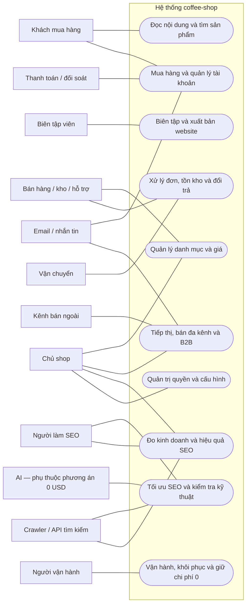
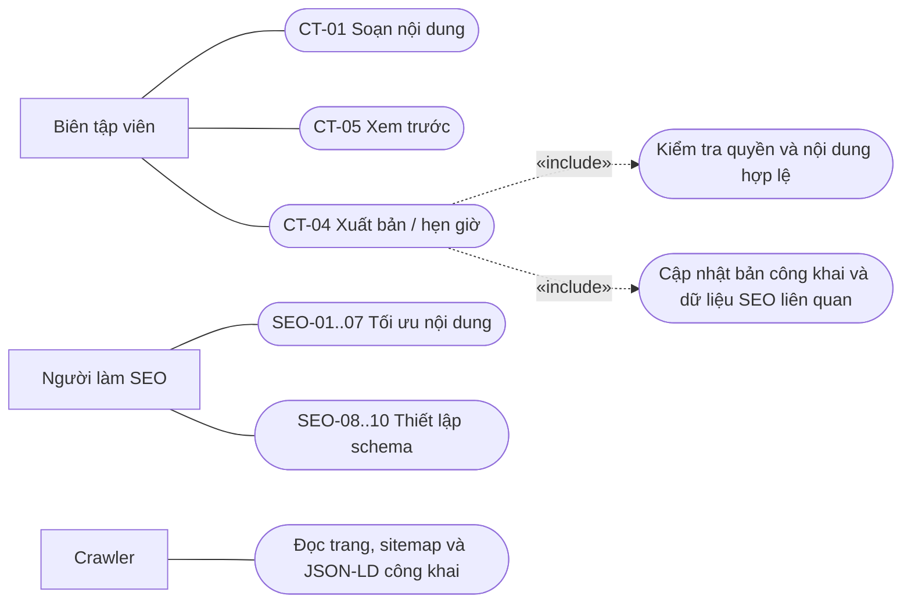
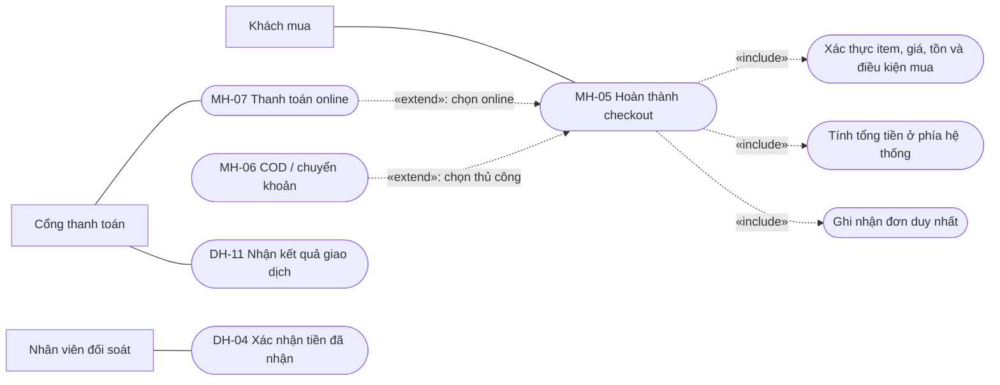
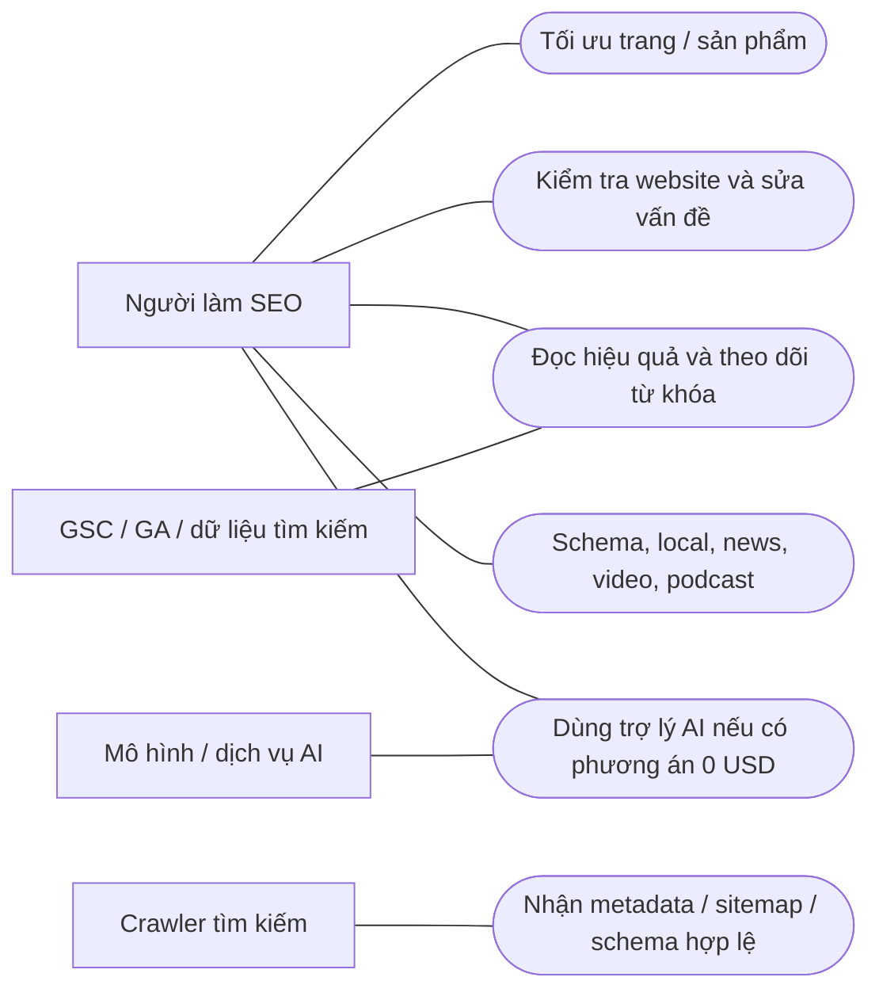

# Coffee-shop — bản đồ use case v0.1

> **BẢN THAM CHIẾU CŨ — KHÔNG CÒN LÀ PHẠM VI HIỆN HÀNH.** Chủ dự án đã thu gọn về một người vận hành, giỏ local, guest checkout bằng SĐT/email; bỏ marketing/B2B/đa thị trường/báo cáo, phân quyền và quản lý tài khoản. Xem [use case hiện hành v0.2](cms-use-cases-solo.md). Các mã và yêu cầu bên dưới chỉ giữ để đối chiếu, không dùng làm backlog triển khai.

Ngày: 01/11/2026. Trạng thái: bản phân tích để rà soát, chưa phải đặc tả đã duyệt hoặc tính năng đã triển khai.

## 1. Yêu cầu gốc đã xác nhận

1. Tự viết hệ thống cho duy nhất dự án **coffee-shop**.
2. Lấy WordPress làm chuẩn tham chiếu nội dung, WooCommerce/Shopify làm chuẩn tham chiếu bán hàng; lấy Rank Math trả phí làm chuẩn tham chiếu SEO.
3. Không xây cơ chế cài/chạy plugin. Các nghiệp vụ SEO được tích hợp trực tiếp trong sản phẩm.
4. Tổng chi phí vận hành mục tiêu **$0, ngoại trừ domain**; không mặc định chấp nhận phí API, AI, email, lưu trữ vượt quota hoặc phí cổng thanh toán.
5. Làm tác nhân, ranh giới, use case và quy tắc nghiệp vụ trước; chưa chọn framework admin, database, layout màn hình hoặc chia MVP.

Mục tiêu là hợp các năng lực nghiệp vụ cần đối chiếu từ ba nền tảng, không chỉ lấy phần giao nhau. Không rút phạm vi về website danh mục. Không tạo nền tảng SaaS cho người khác mở shop.

“Đạt toàn bộ” hiện là **mục tiêu độ phủ**, chưa phải kết luận đã đạt. Bản v0.1 lập bản đồ miền nghiệp vụ và các luồng quan trọng; cần đối chiếu tiếp từng khả năng trong tài liệu tham chiếu trước khi ký phạm vi. Các dòng dưới là thiết kế đề xuất cho coffee-shop, không khẳng định cả ba nền tảng đều có sẵn từng dòng trong core hoặc mọi gói dịch vụ.

### Hai ràng buộc phải giữ đồng thời

- Giữ mục tiêu chức năng; một nghiệp vụ khó đáp ứng $0 vẫn được ghi nhận, không lặng lẽ xóa.
- Không hứa miễn phí vô hạn. Chỉ đánh dấu đạt sau khi có cách thực hiện, giới hạn quy mô và kiểm chứng chi phí. Chi phí giao dịch/thanh toán hoặc dịch vụ ngoài có phát sinh phải được nêu riêng, không giấu trong “hosting miễn phí”.

Không sao chép nền tảng plugin, kho theme, hệ license, hỗ trợ thương mại của nhà cung cấp, tài trợ/vay vốn hay dịch vụ tài chính mang thương hiệu Shopify. Với tính năng phụ thuộc dịch vụ độc quyền, đối chiếu mục tiêu nghiệp vụ và ghi giới hạn thay thế. Đa chi nhánh/kho là nghiệp vụ trong một shop, khác với quản lý nhiều website.

## 2. Tác nhân và ranh giới

| Mã | Tác nhân | Mục tiêu |
|---|---|---|
| A01 | Khách vãng lai | Khám phá nội dung/sản phẩm, mua không cần tài khoản, liên hệ |
| A02 | Khách có tài khoản | Quản lý hồ sơ/địa chỉ, đơn hàng, tải hàng số, gửi yêu cầu sau mua |
| A03 | Khách doanh nghiệp | Mua theo bảng giá/điều kiện bán sỉ được duyệt |
| A04 | Chủ shop / quản trị | Thiết lập, cấp quyền, theo dõi kinh doanh và toàn quyền xử lý |
| A05 | Biên tập viên / tác giả | Soạn, duyệt và xuất bản theo quyền được giao |
| A06 | Người phụ trách SEO | Tối ưu, kiểm tra, theo dõi hiệu quả và sửa lỗi tìm kiếm |
| A07 | Nhân viên bán hàng / hỗ trợ | Tạo và xử lý đơn, giao tiếp, đổi trả theo quyền |
| A08 | Nhân viên kho / giao nhận | Nhập/điều chỉnh tồn, đóng gói, giao và nhận hàng trả |
| A09 | Lập trình viên / người vận hành | Phát hành, nhập/xuất dữ liệu, khôi phục, chẩn đoán và kiểm soát quota |
| E01 | Cổng thanh toán / nguồn đối soát | Thông báo hoặc cung cấp bằng chứng giao dịch nếu được kết nối |
| E02 | Đơn vị vận chuyển / điểm nhận | Nhận yêu cầu giao và cung cấp tình trạng vận chuyển nếu được kết nối |
| E03 | Dịch vụ email / kênh nhắn tin | Chuyển thông báo và phản hồi trạng thái gửi |
| E04 | Search Console / GA / API tìm kiếm | Cấp quyền và trả dữ liệu phục vụ SEO/đo lường |
| E05 | Công cụ tìm kiếm / crawler | Đọc trang, sitemap, robots và dữ liệu có cấu trúc |
| E06 | Dịch vụ/mô hình AI | Sinh/gợi ý nội dung, liên kết hoặc dữ liệu theo dõi AI khi có phương án $0 |
| E07 | Kênh bán ngoài | Nhận feed/đồng bộ, trả đơn và trạng thái nếu tích hợp |

Đây là vai trò, không phải yêu cầu tuyển từng ấy người; chủ shop có thể giữ nhiều vai trò. Quyền thực thi cần được kiểm tra theo tài nguyên và thao tác. A02/A03 có các khả năng phù hợp của A01.

Ranh giới hệ thống gồm storefront, admin, nghiệp vụ nội dung/bán hàng/SEO và tác vụ nền của coffee-shop. Cloudflare là môi trường triển khai. Bộ lập lịch, database và hàng đợi là thành phần bên trong, không phải người dùng hệ thống. Tác nhân E01–E07 không có nghĩa phải kết nối ngay hoặc đã có dịch vụ miễn phí.

## 3. Sơ đồ use case tổng quan

Mermaid dùng oval để biểu diễn use case và khung để biểu diễn ranh giới; đây là cách trình bày use case bằng flowchart, không phải cú pháp UML chuyên dụng. Mỗi oval tổng quan là nhóm mục tiêu, được tách thành use case có mã bên dưới. Đường nối biểu diễn tham gia, không biểu diễn thứ tự xử lý.

## 4. Danh mục use case theo mục tiêu

Ký hiệu khả thi chi phí: **N** = nghiệp vụ nội bộ, không bắt buộc mua API; vẫn cần kiểm chứng quota. **E** = phụ thuộc dịch vụ/dữ liệu/quyền truy cập bên ngoài. **M** = có cách làm thủ công để tránh mua tích hợp, nhưng không mặc nhiên đạt cùng mức tự động hóa. Không ký hiệu nào là cam kết đã đạt $0.

### 4.1. Nội dung và xây dựng website

Chuẩn tham chiếu: WordPress có tác vụ xuất bản, media, phân quyền và quản trị nội dung. Chi tiết dưới là thiết kế coffee-shop dựa trên các miền đó. [WordPress Features](https://wordpress.org/about/features/)

| Mã | Tác nhân | Mục tiêu / kết quả thành công | Loại |
|---|---|---|---|
| CT-01 | A05 | Soạn bài/trang bằng block, rich text hoặc HTML được cho phép; bản nháp được lưu | N |
| CT-02 | A05 | Tổ chức chuyên mục, tag, tác giả, kiểu nội dung và trường riêng | N |
| CT-03 | A05 | Autosave, so sánh phiên bản, khôi phục và tránh ghi đè chỉnh sửa | N |
| CT-04 | A05 | Gửi duyệt, phản hồi, xuất bản, hẹn giờ và gỡ công khai theo quyền | N |
| CT-05 | A05 | Xem trước thay đổi trên bố cục thật mà khách chưa thấy bản nháp | N |
| CT-06 | A05 | Quản lý media: tải, chọn lại, cắt/đổi kích thước, mô tả, thay và kiểm tra nơi dùng | N |
| CT-07 | A04/A05 | Quản lý menu, header/footer, mẫu trang, block tái dùng và thiết lập giao diện | N |
| CT-08 | A05 | Quản lý public/private/mật khẩu, thùng rác và khôi phục nội dung | N |
| CT-09 | A01/A05 | Bình luận/thảo luận, kiểm duyệt, trả lời và xử lý spam | N/E |
| CT-10 | A09 | Nhập/xuất nội dung, media và quan hệ; báo bản ghi lỗi trước khi áp dụng | N |
| CT-11 | A01 | Đọc bài, archive, feed và tìm kiếm nội dung được công khai | N |
| CT-12 | A05 | Biên tập phiên bản ngôn ngữ và liên kết bản dịch nếu bật thị trường tương ứng | N/M |
| CT-13 | A01/A07 | Gửi và xử lý yêu cầu liên hệ; khách nhận kết quả thật thay vì chỉ ghi console | N/E |

### 4.2. Danh mục, giá và hàng hóa

Các loại luồng sản phẩm/giỏ/checkout/tài khoản được đối chiếu với [WooCommerce critical flows](https://developer.woocommerce.com/docs/contribution/testing/core-critical-flows/). Những quy tắc riêng như lô cà phê bên dưới là đề xuất theo dự án.

| Mã | Tác nhân | Mục tiêu / kết quả thành công | Loại |
|---|---|---|---|
| SP-01 | A07 | Tạo/sửa/nhân bản/ẩn sản phẩm đơn với SKU, nội dung, ảnh và trạng thái | N |
| SP-02 | A07 | Quản lý thuộc tính/biến thể: gói, mức rang, kiểu xay; mỗi biến thể có giá/tồn riêng | N |
| SP-03 | A07 | Bán sản phẩm nhóm, hàng số/tải xuống, sản phẩm ảo và liên kết mua ngoài | N/E |
| SP-04 | A07 | Phân loại theo danh mục, tag, thương hiệu, collection thủ công hoặc điều kiện | N |
| SP-05 | A07 | Thiết lập giá thường, giảm giá theo lịch, giá vốn và quy tắc hiển thị thuế | N |
| SP-06 | A07 | Gắn upsell, cross-sell, sản phẩm liên quan và sản phẩm nổi bật | N |
| SP-07 | A07 | Nhập/xuất và sửa hàng loạt có preview, kiểm tra trùng và báo lỗi | N |
| SP-08 | A08 | Quản lý khối lượng/kích thước, nhóm giao hàng, mã định danh GTIN/MPN | N |
| SP-09 | A08 | Theo dõi lô/ngày rang/hạn sử dụng khi nghiệp vụ cà phê cần; cần chốt quy tắc | N |
| SP-10 | A01/A07 | Xem, gửi, xác minh và kiểm duyệt đánh giá sản phẩm | N |

### 4.3. Mua hàng và tài khoản

| Mã | Tác nhân | Mục tiêu / kết quả thành công | Loại |
|---|---|---|---|
| MH-01 | A01 | Duyệt/lọc/sắp xếp/tìm sản phẩm theo giá, loại và thuộc tính | N |
| MH-02 | A01 | Chọn biến thể, số lượng và xem giá/tình trạng mua tương ứng | N |
| MH-03 | A01 | Thêm/sửa/xóa giỏ, giữ giỏ và biết item nào thay giá/hết hàng | N |
| MH-04 | A01 | Áp mã, gift card/store credit nếu bật; nhận tổng tiền được tính lại hợp lệ | N |
| MH-05 | A01/A02 | Checkout khách vãng lai hoặc đăng nhập, chọn giao/nhận, hoàn thành đơn | N |
| MH-06 | A01 | Chọn COD/chuyển khoản thủ công; xem hướng dẫn và trạng thái chờ xử lý | N/M |
| MH-07 | A01/E01 | Thanh toán online, xác thực giao dịch và tiếp tục khi lỗi/chưa rõ kết quả | E |
| MH-08 | A02 | Đăng ký/đăng nhập, xác minh, khôi phục truy cập và quản lý phiên | N/E |
| MH-09 | A02 | Sửa hồ sơ/địa chỉ, xem đơn, mua lại và thanh toán đơn chưa trả | N/E |
| MH-10 | A01/A02 | Tra cứu đơn bằng cơ chế xác minh an toàn; yêu cầu hủy/đổi/trả | N/E |
| MH-11 | A02 | Nhận quyền tải hàng số có thời hạn/số lần theo đơn hợp lệ | N |
| MH-12 | A01/A02 | Nhận xác nhận mua hàng và cập nhật giao dịch qua kênh đã cấu hình | N/E |
| MH-13 | A02 | Chọn quyền riêng tư/nhận marketing, yêu cầu xuất hoặc xóa dữ liệu theo quy tắc lưu giữ | N |

### 4.4. Đơn hàng, thanh toán và hậu mãi

Chuẩn đối chiếu miền vận hành: [WooCommerce Orders](https://woocommerce.com/documentation/woocommerce/) và [Shopify Help Center](https://help.shopify.com/en/). Các chi tiết kiểm soát sau là quy tắc đề xuất của coffee-shop.

| Mã | Tác nhân | Mục tiêu / kết quả thành công | Loại |
|---|---|---|---|
| DH-01 | A07 | Tạo đơn nháp/đơn thủ công, gửi đường dẫn xác nhận/thanh toán | N/E |
| DH-02 | A07 | Tìm/lọc, xem dòng hàng, lịch sử, ghi chú nội bộ và thông tin khách theo quyền | N |
| DH-03 | A07 | Sửa đơn theo điều kiện cho phép, tính chênh lệch và lưu dấu vết | N |
| DH-04 | A07 | Xác nhận chuyển khoản/COD, đối soát thiếu/thừa/trùng và khoản tiền chưa khớp đơn | N/M/E |
| DH-05 | A07/E01 | Thu/ghi nhận/hoàn tiền một phần hoặc toàn phần, xử lý giao dịch lỗi | N/E |
| DH-06 | A07 | Hủy đơn, giải phóng tồn/ưu đãi và xử lý phần tiền đã thu theo chính sách | N/E |
| DH-07 | A08 | Chia kiện/giao một phần, in phiếu, thêm mã theo dõi và cập nhật giao | N/M/E |
| DH-08 | A07/A08 | Nhận yêu cầu trả/đổi, kiểm hàng, nhập lại tồn phù hợp, hoàn tiền/đổi sản phẩm | N/E |
| DH-09 | A07 | Xuất chứng từ/biên nhận và dữ liệu phục vụ kế toán; hóa đơn điện tử hợp lệ cần đối chiếu riêng | N/E |
| DH-10 | A07/E01 | Rà đơn bất thường, tra soát và tranh chấp thanh toán nếu có cổng hỗ trợ | N/M/E |
| DH-11 | A09 | Xử lý callback/webhook lặp, đến sai thứ tự và retry mà không nhân đôi hiệu ứng | N/E |
| DH-12 | A07 | Lưu trữ/xuất đơn và giữ dữ liệu giao dịch lịch sử độc lập với sản phẩm đã sửa/xóa | N |

### 4.5. Tồn kho, giao nhận và thuế

| Mã | Tác nhân | Mục tiêu / kết quả thành công | Loại |
|---|---|---|---|
| VT-01 | A08 | Nhập, kiểm kê, điều chỉnh tồn kèm lý do và lịch sử | N |
| VT-02 | A08 | Xem tồn thực tế/đã giữ/có thể bán; cảnh báo thấp và quy tắc cho đặt trước | N |
| VT-03 | A08 | Chuyển hàng, phân bổ và xử lý đơn từ nhiều kho/điểm nhận nếu bật | N |
| VT-04 | A04 | Cấu hình vùng giao, biểu phí, miễn phí, nhận tại shop và giao nội vùng | N |
| VT-05 | A08/E02 | Lấy báo giá, tạo/hủy vận đơn, lấy nhãn và nhận tracking tự động | E/M |
| VT-06 | A08 | Nhận hàng từ nhà cung cấp, ghi mua hàng và hàng hoàn khi cần quản lý nguồn tồn | N |
| VT-07 | A04 | Cấu hình thuế, miễn thuế, giá gồm/chưa gồm thuế và làm tròn theo thị trường | N |
| VT-08 | A04/E02 | Xử lý thuế/phí nhập khẩu, mã hàng và ràng buộc giao quốc tế khi bán ngoài nước | N/E/M |

### 4.6. Tiếp thị, khách hàng và báo cáo

| Mã | Tác nhân | Mục tiêu / kết quả thành công | Loại |
|---|---|---|---|
| MK-01 | A04/A07 | Tạo coupon/giảm tự động: điều kiện, giới hạn, kết hợp và lịch hiệu lực | N |
| MK-02 | A04 | Phát hành/thu hồi gift card và quản lý số dư store credit có lịch sử | N |
| MK-03 | A07 | Quản lý hồ sơ, tag, phân khúc khách, ghi chú và lựa chọn nhận liên lạc | N |
| MK-04 | A04/E03 | Tạo/gửi chiến dịch email hoặc tin nhắn, hủy đăng ký và xem kết quả gửi | E |
| MK-05 | A04/E03 | Nhắc giỏ/checkout bỏ dở và chăm sóc sau mua theo đồng ý và lịch đã cấu hình | N/E |
| MK-06 | A04 | Xem doanh thu, đơn, refund, thuế, giảm giá, tồn và hiệu quả sản phẩm/khách | N |
| MK-07 | A04/E04 | Xem funnel, nguồn truy cập, chiến dịch, chuyển đổi và hành vi tìm kiếm nội bộ | N/E |
| MK-08 | A04 | Xuất/lập lịch báo cáo, so sánh kỳ và giải thích khác biệt doanh thu/tổng thu | N/E |
| MK-09 | A04/E07 | Xuất feed sản phẩm; đồng bộ giá/tồn/đơn và xử lý lỗi giữa các kênh | N/E |
| MK-10 | A04/A09 | Tạo tự động hóa theo sự kiện, xem lịch sử chạy và chạy lại an toàn | N |

### 4.7. Các năng lực Shopify nâng cao cần đối chiếu

Giữ trong bản đồ độ phủ; không tự loại vì shop hiện còn nhỏ. Trạng thái tích hợp và chi phí chưa được chốt. B2B và Markets có điều kiện tính năng theo gói ở sản phẩm gốc; ta đối chiếu hành vi, không sao chép cấu trúc gói. [Shopify B2B](https://help.shopify.com/en/manual/b2b/getting-started/features), [Shopify Markets](https://help.shopify.com/en/manual/markets/getting-started/requirements-and-considerations)

| Mã | Tác nhân | Mục tiêu / kết quả thành công | Loại |
|---|---|---|---|
| NC-01 | A03/A07 | Quản lý doanh nghiệp/người mua/địa chỉ, duyệt quyền mua sỉ | N |
| NC-02 | A03/A07 | Bảng giá riêng, số lượng tối thiểu/bậc số lượng, báo giá và đơn sỉ | N |
| NC-03 | A03/A07 | PO, đặt cọc, công nợ/hạn thanh toán và thu tiền theo quyền hạn | N/M/E |
| NC-04 | A04 | Thiết lập thị trường, ngôn ngữ, domain/path, catalog và giá theo vùng | N/E |
| NC-05 | A01/A04 | Hiển thị/thu tiền nhiều tiền tệ, tỷ giá và làm tròn với nguồn tỷ giá xác định | N/M/E |
| NC-06 | A07/A08 | Bán tại quầy, đổi trả chéo online/tại quầy và đồng bộ tồn | N/E |
| NC-07 | A07 | Dùng máy in/máy quét và chế độ mất mạng có cơ chế giải quyết xung đột | N/E |
| NC-08 | A02/A04 | Đăng ký mua định kỳ: lịch giao, đổi/tạm dừng/hủy và lần thu tiền tiếp theo | N/E |
| NC-09 | A04 | Quản lý bundle, thành phần và ảnh hưởng đến giá/tồn/hoàn hàng | N |

Đăng ký định kỳ và một số kênh có thể được sản phẩm gốc cung cấp qua app/extension. “Không làm plugin” ở đây loại cơ chế mở rộng; trạng thái có cần tích hợp trực tiếp các nghiệp vụ đó vẫn phải được chốt. Wishlist, tích điểm, membership và booking được ghi thành câu hỏi đối chiếu mở, không tự nhận là core của cả ba hoặc tự cam kết triển khai.

### 4.8. Quản trị và vận hành

| Mã | Tác nhân | Mục tiêu / kết quả thành công | Loại |
|---|---|---|---|
| HT-01 | A04 | Mời/khóa nhân viên, phân quyền, thu hồi phiên và quản lý xác thực mạnh | N/E |
| HT-02 | A04 | Cấu hình thương hiệu, shop, timezone, locale, tiền tệ, liên hệ, chính sách | N |
| HT-03 | A04 | Quản lý mẫu thông báo và biết thư nào gửi thành công/thất bại | N/E |
| HT-04 | A09 | Quản lý API/token/webhook theo phạm vi; kiểm tra chữ ký và thu hồi truy cập | N/E |
| HT-05 | A09 | Nhập/xuất cấu hình và dữ liệu, chạy thử migration và quay lại khi lỗi | N |
| HT-06 | A09 | Sao lưu/khôi phục có đối chiếu đơn, tiền, tồn và media | N |
| HT-07 | A09 | Phát hành/staging/rollback, kiểm tra sức khỏe và chẩn đoán lỗi | N |
| HT-08 | A04/A09 | Xem nhật ký ai sửa gì, bảo vệ dữ liệu riêng tư và thực thi thời gian lưu | N |
| HT-09 | A09 | Theo dõi quota/tốc độ tăng, hạn chế abuse và dừng tác vụ không thiết yếu trước khi vượt ngân sách | N |
| HT-10 | A09 | Tiếp tục xử lý hợp lệ khi API, email, AI hoặc crawler audit thất bại; retry có giới hạn | N/E |
| HT-11 | A04/A09 | Quản lý domain/SSL, trạng thái tích hợp và quyền sở hữu tài khoản dịch vụ | N/E |

### 4.9. SEO nâng cao

Danh mục mã **SEO-01…SEO-36** và **AI-01…AI-04**, nguồn đối chiếu cùng giới hạn nằm ở [cms-seo-parity.md](cms-seo-parity.md). Đây là miền chính của sản phẩm, không phải việc điền vài trường title/description sau cùng.

## 5. Sơ đồ chi tiết các nghiệp vụ quan trọng

### 5.1. Xuất bản nội dung đã tối ưu

Các liên kết include chỉ áp dụng cho phần bắt buộc của xuất bản. Điểm SEO thấp là cảnh báo trừ khi có quy tắc chặn đã duyệt. Các bước optimize không tự động trở thành điều kiện bắt buộc cho mọi bài viết.

### 5.2. Đặt hàng và nhận tiền

Extension point của MH-05 là bước chọn/thực hiện phương thức thanh toán. COD và chuyển khoản không đồng nghĩa đã thu tiền. Nếu không có cổng đáp ứng $0, MH-07 ở trạng thái chưa đáp ứng, không đổi tên MH-06 thành thanh toán online tự động.

### 5.3. Làm SEO và theo dõi kết quả

## 6. Đặc tả mẫu — các luồng cần khóa quy tắc sớm

### UC-MH-05 — Hoàn thành checkout

- **Mục tiêu/tác nhân:** A01/A02 đặt được một đơn với dữ liệu và tổng tiền đúng.
- **Kích hoạt/tiền điều kiện:** khách chọn đặt hàng; giỏ không rỗng; có phương thức mua đang hoạt động.
- **Luồng chính:** (1) nhập thông tin liên hệ/địa chỉ; (2) chọn giao/nhận; (3) áp ưu đãi; (4) hệ thống xác thực và tính tiền; (5) khách xác nhận; (6) hệ thống ghi đơn, xử lý quyền giữ tồn và cấp mã tra cứu; (7) hiển thị trạng thái cùng hướng dẫn thanh toán.
- **Nhánh lỗi:** giá thay đổi yêu cầu xác nhận lại; hết hàng không tạo đơn vượt khả năng bán; mã hết lượt bị từ chối; gửi lặp/mạng đứt không sinh hai đơn; email lỗi không xóa đơn hợp lệ.
- **Hậu điều kiện:** một đơn duy nhất có snapshot dòng hàng, giá/thuế/phí, trạng thái đơn/thanh toán/giao hàng tách biệt.
- **Nghiệm thu:** hai khách mua sản phẩm cuối cùng không cùng nhận quyền giữ một đơn vị; gửi lại cùng yêu cầu không nhân đôi đơn; sửa giá sản phẩm sau đó không sửa số tiền của đơn cũ. Chính sách thời hạn giữ tồn cần chốt.

### UC-DH-04 — Đối soát chuyển khoản thủ công

- **Tác nhân/kích hoạt:** A07 có quyền mở đơn chờ trả tiền và đối chiếu bằng chứng tiền đã vào.
- **Luồng chính:** xem số tiền/mã tham chiếu → đối chiếu nguồn nhận tiền → ghi số tiền/chứng cứ → xác nhận theo quyền → cập nhật trạng thái và lịch sử.
- **Nhánh lỗi:** thiếu/thừa tiền đưa vào chờ xử lý; một giao dịch không gán toàn bộ cho hai đơn; ảnh biên lai do khách gửi không tự động chứng minh tiền đã vào.
- **Hậu điều kiện/nghiệm thu:** thao tác có người/thời gian/tham chiếu; xác nhận lặp không tăng doanh thu hoặc trừ tồn lần nữa. Đây là thay thế thủ công cho kết nối ngân hàng, không có cùng mức tự động hóa.

### UC-CT-04 — Xuất bản hoặc hẹn giờ

- **Tác nhân/kích hoạt:** A05 có quyền yêu cầu xuất bản một phiên bản nội dung đã lưu.
- **Luồng chính:** chọn phiên bản/thời điểm → xác thực quyền, slug và dữ liệu → lưu yêu cầu → đưa đúng phiên bản ra công khai → cập nhật metadata/sitemap/cache liên quan → thông báo kết quả.
- **Nhánh lỗi:** chưa có quyền chỉ gửi duyệt; slug xung đột trả lỗi; xuất bản thất bại giữ bản đang công khai; lịch dùng timezone của shop; hủy/lùi lịch không để tác vụ cũ xuất bản nhầm.
- **Nghiệm thu:** draft/preview không rò công khai; sửa draft sau khi hẹn giờ không làm đổi phiên bản sẽ xuất bản ngoài quy tắc; các vị trí dùng chung nội dung nhất quán sau khi hoàn tất.

### UC-SEO-16 — Đổi URL và chuyển hướng

- **Tác nhân/kích hoạt:** A06 đổi slug hoặc tạo quy tắc chuyển hướng.
- **Luồng chính:** nhập nguồn/đích/loại → xem tác động → kiểm tra xung đột, vòng lặp và đích → lưu → cập nhật URL công khai, canonical, link nội bộ và sitemap liên quan theo quy tắc đã chọn.
- **Nhánh lỗi:** đích không hợp lệ bị từ chối/cảnh báo rõ; quy tắc regex có preview tập mẫu; quy tắc trùng có thứ tự ưu tiên xác định; đích cần giữ query được xử lý theo chính sách.
- **Nghiệm thu:** URL cũ trả đúng HTTP status và tới đích mong muốn; không có vòng lặp; sitemap không tiếp tục công bố URL cũ đã bỏ. Xóa/410 là trường hợp xử lý URL, không giả làm redirect có đích.

### UC-SEO-24 — Xem hiệu quả tìm kiếm

- **Tác nhân/kích hoạt:** A06 mở báo cáo sau khi kết nối property được cấp quyền.
- **Luồng chính:** xác thực kết nối → đồng bộ theo quota → chuẩn hóa dimension/thời gian → xem trang/query, impressions/clicks/CTR/average position → so kỳ → xuất báo cáo.
- **Nhánh lỗi:** token hết hạn yêu cầu kết nối lại; API giới hạn tạm hoãn; dữ liệu thiếu/chậm có nhãn; không bịa thành số 0; không trộn dữ liệu của property khác.
- **Nghiệm thu:** chỉ số khớp một mẫu nguồn với cùng bộ lọc; hiển thị thời điểm cập nhật và độ phủ. Average position từ GSC không được mô tả thành vị trí SERP chính xác cho mọi người tìm.

### UC-HT-09 — Giữ ngân sách 0 USD

- **Tác nhân/kích hoạt:** A09 kiểm tra ngân sách hoặc hệ thống tiến gần giới hạn đã cấu hình.
- **Luồng chính:** đọc/ước lượng mức sử dụng → so ngân sách từng dịch vụ → cảnh báo → giảm audit/đồng bộ/tác vụ tùy chọn → giới hạn đầu vào → ghi tình trạng và hướng phục hồi.
- **Nhánh lỗi:** số liệu quota trễ phải có khoảng dự phòng; không tự nâng gói/bật tính phí; không ghi sai tiền/tồn để tiết kiệm quota; thao tác chưa thể thực hiện phải trả trạng thái rõ.
- **Nghiệm thu:** test gần/vượt giới hạn; không mất đơn đã nhận; phần không thiết yếu dừng theo ưu tiên. Cam kết $0 chỉ được xác nhận khi chính sách tính phí của từng dịch vụ và rào giới hạn thực tế đã được kiểm chứng; giới hạn trong code không tự tạo hard cap cho nhà cung cấp.

## 7. Các quy tắc xuyên suốt cần chốt

- Quyền: tác giả sửa nội dung nào; ai xuất bản; ai xem dữ liệu khách; ai hoàn tiền; ai sửa cấu hình SEO toàn site.
- Tiền: đơn vị nhỏ nhất, cách làm tròn, thuế, điều kiện giảm giá, phí vận chuyển và tách khoản đã thu/được hoàn.
- Tồn: lúc giữ/trừ/nhả tồn, TTL, backorder, nhiều kho và cạnh tranh cùng sản phẩm cuối.
- Trạng thái: vòng đời nội dung, đơn, giao dịch, fulfillment và đổi trả không gộp thành một cột trạng thái.
- Dữ liệu: không xóa lịch sử giao dịch khi xóa sản phẩm; import có báo lỗi; khôi phục không tạo lại tác vụ thu tiền/gửi đơn đã hoàn tất.
- SEO: một nguồn quyết định metadata/schema; draft không được index; đổi URL xử lý nhất quán; trạng thái tìm kiếm phụ thuộc hệ thống tìm kiếm bên ngoài.
- Chi phí: quota tài khoản dùng chung, giới hạn lưu, tần suất job, xử lý abuse và hành vi khi hết quota.
- Khả dụng: mobile/desktop, bàn phím, nhãn form, thông báo lỗi và trải nghiệm nội dung dài/ảnh lỗi.

## 8. Kiểm chứng yêu cầu Cloudflare miễn phí

Đây là ràng buộc để đánh giá use case, chưa phải quyết định chọn dịch vụ. Snapshot tài liệu ngày 01/11/2026:

| Tài nguyên | Mức miễn phí tham chiếu | Tác động cần tính |
|---|---|---|
| Workers Free | 100.000 request/ngày; giới hạn CPU theo lần gọi | Tách request động/tĩnh và chi phí mỗi luồng; audit nặng cần chia nhỏ/chạy ở môi trường phù hợp |
| D1 Free | 5 triệu dòng đọc/ngày, 100.000 dòng ghi/ngày, 5 GB tổng lưu trữ | Tính cả index, log, analytics, import và truy vấn quét nhiều dòng |
| R2 Standard free tier | 10 GB-month, 1 triệu thao tác class A, 10 triệu class B/tháng | Tính media, backup và số thao tác; vượt free tier có thể có phí |

Nguồn: [Workers pricing](https://developers.cloudflare.com/workers/platform/pricing/), [D1 pricing](https://developers.cloudflare.com/d1/platform/pricing/), [R2 pricing](https://developers.cloudflare.com/r2/pricing/).

Chưa có cam kết $0 cho mọi lưu lượng hoặc quy mô. Email, AI, thông tin SERP độc lập, tỷ giá, cổng thanh toán, vận chuyển và kênh bán phải có phiếu khả thi riêng. Một chức năng có cách nhập tay chỉ đạt tương đương kết quả thủ công; không được đánh dấu đạt tương đương tự động hóa.

## 9. Các quyết định mở và thứ tự làm tiếp

| Mã | Cần quyết định / kiểm chứng | Ảnh hưởng |
|---|---|---|
| Q-01 | Chuẩn Shopify đến mức nào: online commerce, B2B/Markets, POS, hay cả dịch vụ độc quyền | Độ phủ NC và giới hạn tương đương |
| Q-02 | “Trừ plugin” loại cơ chế plugin hay loại luôn nghiệp vụ thường cần extension như subscriptions | Chốt các dòng bổ sung, không tự đoán |
| Q-03 | Rank Math trả phí: bộ SEO là bắt buộc; AI được ghi riêng, có yêu cầu ngang chức năng AI mới không | Khả thi AI-01…04 với $0 |
| Q-04 | Quy mô mục tiêu: số sản phẩm/biến thể/bài/ảnh, đơn/ngày, khách/ngày, thời gian giữ dữ liệu | Chứng minh free tier và tiêu chí tải |
| Q-05 | Phương thức trả tiền/giao hàng, mức thủ công chấp nhận và nguồn dữ liệu SEO | MH/DH/VT và SEO analytics |
| Q-06 | Các vai trò thực tế, quyền và mức duyệt; thị trường/ngôn ngữ áp dụng | Chi tiết luồng và quyền |

Trình tự waterfall tiếp theo: **rà bản đồ use case → đối chiếu tính năng tham chiếu và đóng các khoảng trống → đặc tả luồng/quy tắc/nghiệm thu → kiểm chứng từng phụ thuộc $0 → chốt yêu cầu → thiết kế dữ liệu/kiến trúc/màn hình → kế hoạch triển khai**.

Chưa phân kỳ để loại bỏ tính năng. Một yêu cầu chỉ được coi hoàn thành khi có chuỗi: nguồn/yêu cầu chủ dự án → mã use case → quy tắc → ca nghiệm thu → kết quả kiểm chứng. Bản checklist cũ đã đánh dấu hết hiệu lực về phạm vi.
